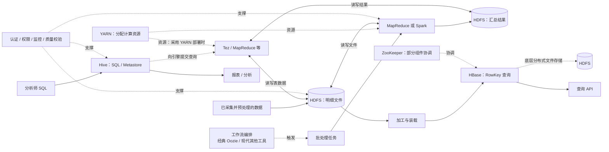

# Hadoop 生态圈 Vibe 知识视频｜完整分镜表

> 版本：V1.1（00–02 章网页快节奏版；03–09 章保留完整讲解参考）<br>
> 编制日期：2026-11-17<br>
> 交付用途：00–02 网页样片制作与逐镜验收，03–09 完整讲解参考<br>
> 示例业务：一批已完成采集和预处理的**电商订单数据**，既要生成省份销售报表，也要支持订单号查询<br>
> 内容范围：从“已清洗数据准备入 Hadoop”开始，到存储、运行计算、分析/服务分支、工作流保障与输出

## 0. 创作定位与正确的技术叙事

**形式**：16:9 横版、1920×1080、30fps；深色极简科技感，前景为精确的二维/三维伪空间图形，动态图形承担知识解释，不是纯装饰。当前网页样片仅用中文字幕与图形讲解，不做音频，不导出。03–09 的原旁白保留作讲解参考。

**主视觉隐喻**：数据中心是一座可以俯视的“数据工厂”。每个功能区是固定位置的空间，镜头移动而不是反复生成无关画面：Hadoop Common（底层支撑带）、HDFS（分布式仓库）、YARN（计算资源调度大厅）、MapReduce/Spark（可选择的计算车间）、Hive（SQL 分析室）、HBase（低延迟查询服务区）；ZooKeeper、工作流编排、安全监控属于侧边支撑系统。

**知识上最关键的约束**：

1. **不是单链**：不能把 `HDFS → YARN → MapReduce → Spark → Hive → HBase` 画成每一条数据的固定顺序。
2. **存储 vs 资源**：HDFS 放文件、定位数据块；YARN 给运行中的分布式应用分配计算资源；Hadoop Common 为核心模块提供共用的基础库和工具。三者角色不同。
3. **计算多选一或按需组合**：MapReduce、Spark 是计算方案；Hive 是 SQL 分析入口，可能使用 Tez/MapReduce 等执行引擎（受版本和部署配置影响）。
4. **分析和服务分支**：Hive 适合扫描/聚合分析；HBase 适合按 RowKey 的随机读写，通常要另建服务表与装载流程。
5. **外围服务不承载业务数据主通道**：ZooKeeper 负责部分分布式协调；工作流工具负责作业依赖。Oozie 是经典生态组件，但 **Apache Oozie 在 2025 年已退役**，视频须明确标注其历史地位，不建议介绍为仍在活跃发展的首选组件。
6. **容错不是绝对保证**：副本、重试、HA、校验属于不同维度，不能宣称“任何情况下永不丢失、永不失败”。

### 视频叙事问题

- **问题 A**：2026-11-16 各省有多少订单、销售总额是多少？→ HDFS / 分布式计算 / Hive / 报表。
- **问题 B**：给定 `order_id`，如何较快获得订单状态？→ 处理后的服务数据 → HBase → API（仅作可选架构示例）。

### 全局场景地图（制作时建议始终保持空间关系一致）



> 此图为**角色关系示意**，不是逐字节的物理数据路径。实际 Hive、Spark、HBase、YARN 的组合因版本和部署而异。

## 1. 总时间轴

| 章节 | 时间 | 教学任务 | 视觉高潮 |
|---|---|---|---|
| 00｜开场与全局问题 | 00:00–00:26 | 提出完整问题、建立分层结构 | 订单暴涨；地图开层并亮出双出口 |
| 01｜数据入湖与组织 | 00:26–00:48 | 定义示例数据、组织文件 | 目标分区锁定；碎文件吸合 |
| 02｜HDFS：分布式存储 | 00:48–02:00 | 拆分、定位、复制、读取、恢复 | 巨块三分；写入绕开 NameNode；失联改道、新副本落位 |

**本版到 02:00 结束，共 16 镜，原来为 03:44。** 03–09 暂不改、不做；下表与这些章节逐镜时间均为 V1.0 参考，不是紧接样片的网页时间轴，续制时再统一衔接。

| 后续章节（待制作） | V1.0 参考时间 | 教学任务 | 视觉高潮 |
|---|---|---|---|
| 03｜YARN：资源与任务启动 | 03:44–05:09 | 资源管理、容器、AM、本地性 | YARN 资源分配 |
| 04｜并行计算：MapReduce 与 Spark | 05:09–07:37 | Map/Shuffle/Reduce 与 Spark 的关系 | Shuffle 粒子汇流 |
| 05｜Hive：SQL 数据分析 | 07:37–09:13 | Hive SQL、Metastore、分区与执行引擎 | SQL 变图表 |
| 06｜HBase：在线随机读写分支 | 09:13–10:59 | HBase 服务分支、写入与随机读写 | RowKey 精准命中 |
| 07｜编排、协调与可靠运行 | 10:59–12:44 | 工作流、Oozie 现状、ZooKeeper、可靠性、安全 | 多层容错恢复 |
| 08｜服务输出与业务闭环 | 12:44–13:43 | 两类业务输出及持续更新 | 报表/API 双终点 |
| 09｜总架构收束 | 13:43–14:31 | 最终架构图与纠错总结 | 错误串行图纠正 |

V1.0 完整讲解参考为 14:31（59 镜）；V1.1 尚未确定全片时长。

## 2. 完整逐镜头分镜表

**00–02 声音关闭也要看懂。** “视觉节拍”按入镜后的相对秒数标记；先看主体、再看关系变化、最后留出读图时间。开场半秒内有主体动作；每个 6–9 秒的镜头至少有两个可见的状态变化，用位置、尺寸、数量或路线变化讲解，而非每屏同样淡入。每次只突出一条主要关系。系统设为减少动态效果时，保留状态切换与字幕，移除疾行拖影、震动和快推。

03–09 的“旁白”与旧节奏均只作完整讲解参考。

### 00｜开场与全局问题

| 镜头 / 网页时间 | 画面与知识动作 | 无声字幕 / 标签 | 视觉节拍（镜内秒） |
|---|---|---|---|
| **S01**<br>00:00–00:06<br>6 秒 | 一张 O-1001 订单卡从近景闯入，由一叠复制卡展开为订单洪流。 | 一批订单进入 Hadoop 后，会发生什么？／汇总分析、订单点查 | 0–0.5 卡片即动；0.7–2.8 数量跃升至 1,000,000+（规模示意）；3.2 双问题板亮起。 |
| **S02**<br>00:06–00:12<br>6 秒 | 采集、清洗、去重、校验依次完成，数据工厂门打开。 | 从已预处理的订单开始 | 0–1.5 四枚状态依次锁定；1.6–3.2 门闸分开，订单文件从门外穿入。 |
| **S03**<br>00:12–00:20<br>8 秒 | 同一地图内展开 HDFS、YARN、计算／分析／服务；Hive 面向报表，HBase 面向点查。 | 存储、资源、计算、分析和服务各有分工，不是单链。 | 0–2.7 由下至上展开三层；3.4–5.5 路线铺开并点亮两个出口，读图定格。 |
| **S04**<br>00:20–00:26<br>6 秒 | 上层留在原位，Common 支撑带从地图下方升起；点线连核心模块，不走订单。 | Hadoop Common：共享库、工具、基础接口 | 0–1.4 底座从下方入位；1.4–3.0 点线逐段接入，衬出底座与业务通道的区别。 |

### 01｜数据入湖与组织

| 镜头 / 网页时间 | 画面与知识动作 | 无声字幕 / 标签 | 视觉节拍（镜内秒） |
|---|---|---|---|
| **S05**<br>00:26–00:34<br>8 秒 | 样例订单明细拉开；字段展示完整。用两种高亮比较汇总列与 O-1001 单条状态。 | 汇总看省份和金额；点查用订单号找状态。 | 0–1.7 三行依次入位；2.5 汇总列被框选；4.3 切到 O-1001 的订单号和状态。 |
| **S06**<br>00:34–00:42<br>8 秒 | 展开目录树，锁定 `dt=2026-11-16/`，将 Parquet 文件成组放入目标分区。 | 按日期分区；Parquet 文件（示例） | 0–2.0 目录展开；2.0–2.6 目标分区锁亮；2.6–5.4 文件沿导轨逐个落位。 |
| **S07**<br>00:42–00:48<br>6 秒 | 订单小文件堆满左侧，批量吸合成右侧少数大文件。 | 同一分区合并小文件，记录不变。 | 0–1.2 碎文件涌入；1.8–3.8 碎片成束吸合；停在左右对比。 |

### 02｜HDFS：分布式存储

| 镜头 / 网页时间 | 画面与知识动作 | 无声字幕 / 标签 | 视觉节拍（镜内秒） |
|---|---|---|---|
| **S08**<br>00:48–00:55<br>7 秒 | 进入分布式仓库：上方 NameNode 管目录，下方 DataNodes 存文件数据。 | NameNode 管目录和块位置；DataNode 存块。 | 0–1.1 仓库下沉入场；1.3–3.8 货架升起，块落到多个节点。 |
| **S09**<br>00:55–01:02<br>7 秒 | 近景巨型文件被两道切线切成 B1/B2/B3，三个块飞向不同节点。 | 按配置切块；B1 / B2 / B3 仅作示例。 | 0–1.5 切线扫过文件；1.5–2.9 三块拉开；2.9–5.3 飞入节点，落位有轮廓回波。 |
| **S10**<br>01:02–01:11<br>9 秒 | 上路交换元数据，下路直发数据块，NameNode 不在数据路线上。 | 申请创建 → 返回目标 → 客户端直写 DataNode | 0.4–2.4 小型虚线控制包上行；2.4–4.6 控制包返回；4.6–7.0 大数据块从下路穿过。 |
| **S11**<br>01:11–01:19<br>8 秒 | 同一个 B2 沿 Client → DN-A → DN-B → DN-C 传递，落地一个就保留一个。 | 同一个 B2 的副本；示例副本因子 3，可配置。 | 0.5–5.3 三段实线先后推进；到站逐个亮出 B2，最后同屏看清三个副本。 |
| **S12**<br>01:19–01:26<br>7 秒 | 拉开看到机架 A/B，B2 跨机架放置；一机架不可用时看另一机架副本。 | 放置考虑机架布局，不保证所有故障下都可读。 | 0–1.3 两个机架拉开；1.3–3.2 跨机架路线冲过间隙；3.5 以机架 A 不可用为例，机架 B 留亮。 |
| **S13**<br>01:26–01:34<br>8 秒 | 任务询问 NameNode 后锁定较近的可用副本，B2 从 DataNode 返回。 | 先定位，再直接读；条件允许时优先就近。 | 0.3–3.1 查询去回；3.2–4.1 圈定较近节点；4.1–6.4 大块逆向返回任务端。 |
| **S14**<br>01:34–01:43<br>9 秒 | DN-A 心跳中断，NameNode 超时标为不可用；读路切到 DN-B。 | 心跳／块报告 → 超时 → 改读存活副本 | 0–2 展示心跳；2.0 原路径熄灭、节点出现失联记号；3.8 超时；5.3–7.5 替代路径画出并返回 B2。 |
| **S15**<br>01:43–01:52<br>9 秒 | NameNode 指派重新复制，DN-B 横向把 B2 发给 DN-D；可用副本回到目标数。 | 2/3 → 3/3；重新复制降低风险，不保证数据不丢。 | 0.2–2.5 下发指令；2.5–5.7 块沿低位实线传送；约 5.7 新副本落位、计量条补齐。 |
| **S16**<br>01:52–02:00<br>8 秒 | 可选 HA：Active 写共享日志，Standby 同步；失联后在满足条件时接任。下方 DataNode 层始终不动。 | 切换的是元数据服务，不是迁移文件。 | 0.3–3.1 展示日志的写入与读取；3.3 原 Active 断开；约 5.0 接任状态和新写入方向亮出，留到片尾。 |

### 03｜YARN：资源与任务启动

| 镜头 / 时间 | 画面构图与知识动作 | 完整旁白（可直接配音） | 屏幕文字与标签 | 动效、转场与音效 |
|---|---|---|---|---|
| **S17**<br>03:44–03:57<br>13 秒 | 订单分析任务到来：屏幕叠加“统计各省销售额”任务卡，仓库里数据不动；任务卡进入资源大厅。 | 数据已经存好了。现在有人提交分析任务：统计昨天各省订单数与销售额。接下来的问题，不是数据放哪儿，而是谁来提供计算资源。 | Job：按省汇总订单数与销售额 | 界面从仓库平移至资源管理大厅 |
| **S18**<br>03:57–04:12<br>15 秒 | YARN 的职责：ResourceManager 总调度台亮起，多个 NodeManager 分别守护计算节点。 | YARN 负责集群的计算资源管理。ResourceManager 做集群级资源分配；每台机器上的 NodeManager，负责管理本机容器和汇报状态。 | ResourceManager｜NodeManager｜Container | 主控台发出资源分配光束；节点状态心跳闪烁 |
| **S19**<br>04:12–04:27<br>15 秒 | 提交应用与 AM：Client 提交 Application；ResourceManager 先为 ApplicationMaster 分配起始容器。 | 应用提交后，YARN 通常先启动对应的 ApplicationMaster。它代表这个应用继续申请资源、组织任务，并跟踪执行过程。 | Application → ApplicationMaster | 一枚 ApplicationMaster 卡片从调度台滑入空闲容器 |
| **S20**<br>04:27–04:41<br>14 秒 | 容器不是数据块：CPU/内存资源条分配到 Node-A/B/C，容器内出现任务 Worker。 | 这里的 Container 可以理解为一次任务得到的 CPU、内存等资源额度及运行环境。它不是 HDFS 的 Block，资源管理和数据存储不要混为一谈。 | Container ≠ HDFS Block｜CPU / Memory | 左右对照：资源盒与数据盒分别展示 |
| **S21**<br>04:41–04:56<br>15 秒 | 数据本地性：调度器在几个候选节点中挑选距离数据更近的任务位置；跨机架网络线逐渐减少。 | 调度时会尽量利用数据位置，让任务靠近对应数据块运行。但最终还要受资源、队列和机器状态限制，并不是总能完全本地化。 | Data locality：优先就近，不保证总能做到 | 热力线由远端切换到近端 |
| **S22**<br>04:56–05:09<br>13 秒 | 准备执行分叉：画面形成两条计算通道：左 MapReduce，右 Spark；YARN 在背后提供资源。 | 有了计算资源，具体怎么处理数据？这里可以选不同计算框架。我们先看经典的 MapReduce，再看另一条常用路线 Spark。 | 两条可选计算路径：MapReduce / Spark | 双通道开门；避免画成 MR 箭头指向 Spark |

### 04｜并行计算：MapReduce 与 Spark

| 镜头 / 时间 | 画面构图与知识动作 | 完整旁白（可直接配音） | 屏幕文字与标签 | 动效、转场与音效 |
|---|---|---|---|---|
| **S23**<br>05:09–05:22<br>13 秒 | MapReduce：任务拆分：订单数据块生成多个 Map Task，分别进不同工作台。 | MapReduce 的核心思想是分而治之。整个输入被划分为若干处理分片，多个 Map 任务可以并行读取并加工数据。 | Map stage：并行读取与映射 | 画面分屏 4 个工作台同步启动 |
| **S24**<br>05:22–05:37<br>15 秒 | Map：生成键值对：示例订单：“江苏 100、广东 80、江苏 50”被映射为 (省份,金额) 卡片。 | 对于按省统计销售额，Map 阶段可以把每条订单映射成键值对：省份作为 key，金额作为 value。 | (江苏,100)｜(广东,80)｜(江苏,50) | 字段折叠为 KV 卡片，带轻快敲击音 |
| **S25**<br>05:37–05:53<br>16 秒 | Combiner 的可选优化：某工作台里两个同地区小卡先局部合并，右侧加注“仅适用于满足条件的聚合”。 | 有时可以使用 Combiner，在传输前做局部聚合，减少网络数据量。但它只是可选优化，不是每个 MapReduce 作业都会使用。 | Combiner（可选）：局部汇总 | 两张卡收拢；角标 OPTIONAL |
| **S26**<br>05:53–06:10<br>17 秒 | Shuffle：重新分组：不同 Map 输出按 key 同色聚类，经过网络交换、分区、排序后到达不同 Reduce。 | 接下来是 Shuffle。系统把相同 key 的数据组织到同一组，再送到对应的 Reduce 任务。这通常涉及分区、排序和网络传输。 | Shuffle：Partition → Transfer → Sort/Group | 同色粒子跨工作台流动，形成颜色车道 |
| **S27**<br>06:10–06:25<br>15 秒 | Reduce：聚合：江苏组 100+50 → 150；广东组 80；两个数字汇聚为汇总表。 | Reduce 对每个省份的数值做汇总。最终，我们得到各省订单金额的统计结果；如果还要计数，也可以同时维护计数指标。 | Reduce：SUM(amount) / COUNT(*) | 数字滚动累计，表格整齐落位 |
| **S28**<br>06:25–06:38<br>13 秒 | 结果写回 HDFS：分布式结果文件回到 HDFS 的结果目录；与原始/明细区分层。 | 计算结果通常会写回 HDFS 的目标位置，供下一步加工或查询使用。计算任务结束，不代表文件从此离开分布式存储。 | 输出示例：/warehouse/dws/province_sales/ | 线条从计算车间返回仓库结果区 |
| **S29**<br>06:38–06:54<br>16 秒 | Spark：另一种执行框架：镜头切到 Spark 通道，同一分析以过滤、分组、聚合组成执行图。 | Spark 也可以读取 HDFS 上的数据，然后用更丰富的算子构建计算过程。它会把作业拆成阶段和任务，由 Driver 协调 Executor 执行。 | Spark：Driver → Stages / Tasks → Executors | 操作符卡拼成 DAG；节点依赖边逐个亮起 |
| **S30**<br>06:54–07:09<br>15 秒 | Spark 与 YARN 的关系：Spark Driver/Executors 作为应用资源运行于 YARN 管理的节点；角标提示“此处采用 Spark on YARN”。 | 本片示范 Spark 运行在 YARN 上，因此资源仍由 YARN 分配。不过 Spark 也能部署在其他集群管理环境里，它并不只能依赖 YARN。 | 示例部署：Spark on YARN（并非唯一方式） | 镜头抬起透视两层；YARN 发资源，Spark 执行任务 |
| **S31**<br>07:09–07:23<br>14 秒 | 缓存与重复计算：两轮计算都要读取同一份订单；Spark 缓存后第二次计算绕开重复读盘（示意）。 | Spark 可以根据任务需要缓存数据，特别适合重复使用相同中间结果的场景。但不是所有任务都只在内存中完成，Shuffle 也可能涉及磁盘。 | Cache：按需缓存，不等于完全不落盘 | 第一次数据进入缓存圈；第二次复用亮起 |
| **S32**<br>07:23–07:37<br>14 秒 | 如何选计算方案：MapReduce 和 Spark 两个通道并排，分别标出“批处理模型”与“通用计算引擎”；最终汇合到结果存储。 | 所以 MapReduce 和 Spark 是不同的计算方案，通常按任务需求选择，而不是数据必须先跑完 MapReduce、再跑 Spark。两者都可以读写 HDFS。 | MapReduce ↔ Spark：可选路线，不是先后步骤 | 双通道一起进入 HDFS 结果区；暂停一秒强化区别 |

### 05｜Hive：SQL 数据分析

| 镜头 / 时间 | 画面构图与知识动作 | 完整旁白（可直接配音） | 屏幕文字与标签 | 动效、转场与音效 |
|---|---|---|---|---|
| **S33**<br>07:37–07:51<br>14 秒 | 分析师提出 SQL：业务分析师在查询窗输入：统计指定日期各省订单与销售额。 | 现在业务同事不想自己编写分布式计算程序，只想用 SQL 提问。Hive 就提供了这样的数据仓库分析入口。 | Hive：SQL 数据分析入口 | 光标逐字敲出 SELECT / FROM / GROUP BY |
| **S34**<br>07:51–08:08<br>17 秒 | 表结构与数据文件不是一回事：一侧 HDFS 放 Parquet 文件；另一侧 Hive Metastore 保存表结构、列、分区与存储位置。 | Hive 表并不等于把所有订单复制进一个传统数据库。它的 Metastore 主要保存表、列、分区和位置等元数据，真正的数据仍位于底层存储。 | Hive Metastore ≠ 业务数据本体 | 表格目录与数据文件以虚线关联；镜头双焦点 |
| **S35**<br>08:08–08:25<br>17 秒 | 分区裁剪：日期目录 dt=11-15、11-16、11-17 排列，查询只选择 11-16；其他目录变暗。 | 如果表按日期分区，而查询明确指定了日期，执行计划就有机会只读取相关分区，避免无意义地扫描所有日期的数据。 | Partition pruning：只选必要的分区 | 不匹配目录降低亮度，读取线只落到目标日期 |
| **S36**<br>08:25–08:42<br>17 秒 | SQL 到执行计划：SQL 进入 HiveServer2，连接 Metastore 获取元数据，生成计划后指向执行引擎。 | 用户可以通过 HiveServer2 提交 SQL。系统解析并优化查询，结合 Metastore 中的信息生成执行计划，再交给配置的执行引擎处理。 | SQL → 解析优化 → 执行计划 → 引擎 | 文字化为流程图；过程逐节点着色 |
| **S37**<br>08:42–08:57<br>15 秒 | Hive 不是计算引擎的唯一身份：引擎区展示 Tez 与经典 MapReduce；Spark 用“历史/特定环境支持”角标。 | Hive 更像统一的 SQL 分析层。真正执行查询时，会依赖具体版本与配置中的计算引擎，例如 Tez 或 MapReduce；不应把 Hive 直接画成另一个 YARN。 | Hive SQL ≠ HDFS ≠ YARN｜Tez / MR（依版本而定） | 三层解耦，分层高亮；底部小字提示版本差异 |
| **S38**<br>08:57–09:13<br>16 秒 | SQL 变为结果：省份、订单数和销售额逐步填入二维表，继而变为柱形图。 | 查询运行后，结果返回分析入口，或写成新的汇总表。至此，同一批订单已经从明细数据变成了可读、可比较的业务指标。 | province｜orders｜gmv | 查询表流畅形变为柱状图，微微上扬的音乐 |

### 06｜HBase：在线随机读写分支

| 镜头 / 时间 | 画面构图与知识动作 | 完整旁白（可直接配音） | 屏幕文字与标签 | 动效、转场与音效 |
|---|---|---|---|---|
| **S39**<br>09:13–09:27<br>14 秒 | 第二个业务问题：画面上方保留统计报表；下方一个用户输入订单号，请求查询订单状态。 | 不过，报表和点查不是同一个问题。如果用户只想立刻查询某笔订单的状态，面向批量分析的 Hive 通常不是最合适的访问入口。 | 问题 B：按 order_id 查一条订单 | 分屏：左侧批量统计 / 右侧单笔查询 |
| **S40**<br>09:27–09:44<br>17 秒 | 从明细加工到 HBase 服务表：从 HDFS 明细区拉出旁路，经 Spark/批处理装载到 HBase；不要从 Hive 查询结果直接强制串行进入。 | 这时可以另外建设 HBase 服务表。我们把适合点查的订单记录，从已处理数据中装载进去。这是一条并行的服务分支，不是每条数据的必经站。 | HDFS 明细 → 加工/装载 → HBase（可选） | 主干与分支分色；分岔线清晰出现 |
| **S41**<br>09:44–09:59<br>15 秒 | RowKey 与 Region：订单号作为示意 RowKey，数据依键范围分布在多个 Region 中。 | HBase 通过 RowKey 组织记录，表可按键范围拆分成多个 Region，由不同 RegionServer 管理。真实系统还要仔细设计 RowKey，避免热点。 | RowKey / Region / RegionServer | 键空间拉成连续轴并切成区域，分配到三台服务器 |
| **S42**<br>09:59–10:15<br>16 秒 | HBase 写入内部：写入请求到达 RegionServer，依次显示 WAL 与 MemStore，随后后台 Flush 到 HFile/HDFS。 | 写入时，RegionServer 会使用预写日志 WAL 和内存结构 MemStore。后续数据刷写成 HFile，底层通常依赖 HDFS，兼顾写入能力与持久化。 | WAL → MemStore → Flush → HFile（示意简化） | 两路写入动作同步表现；磁盘落地轻响 |
| **S43**<br>10:15–10:31<br>16 秒 | 按 RowKey 读取：客户端发送订单号，请求路由到对应 RegionServer，返回订单状态；动画控制在短路径。 | 读取时，客户端定位对应的 RegionServer，再按 RowKey 查询数据。对于合理设计的键值访问，HBase 能提供低延迟的随机读写能力。 | GET order_id → order_status | 输入框中订单号变成光点直达目标 Region |
| **S44**<br>10:31–10:45<br>14 秒 | 数据服务的更新时效：界面左侧为每日批量装载，右侧为持续更新通道；显示更新时间差与数据新鲜度指标。 | 还有一个容易混淆的地方：HBase 查询可以很快，但如果服务表每天才更新一次，查到的数据也可能不是最新的。查询速度和数据更新时效，是两个不同问题。 | 低延迟查询 ≠ 实时数据同步 | 左右时钟对照；旧记录弹出“待同步”角标 |
| **S45**<br>10:45–10:59<br>14 秒 | Hive 与 HBase 的选择：左侧 Hive 批量聚合成报表，右侧 HBase 单条查状态；背后共享 HDFS 层的概念联系。 | 记住它们的分工：Hive 侧重大规模分析与 SQL 查询，HBase 侧重以 RowKey 为中心的随机读写。并不是谁更高级，而是服务于不同需求。 | Hive＝分析｜HBase＝随机读写 | 左右等宽对比，最后合入总架构 |

### 07｜编排、协调与可靠运行

| 镜头 / 时间 | 画面构图与知识动作 | 完整旁白（可直接配音） | 屏幕文字与标签 | 动效、转场与音效 |
|---|---|---|---|---|
| **S46**<br>10:59–11:13<br>14 秒 | 把每天的作业连起来：由多个作业组成的 DAG：等待数据 → 明细校验 → 聚合 → 更新服务表 → 通知。 | 真实系统里，数据不是只运行一天。每天都需要按依赖关系重复执行：先等数据到齐，再计算、校验、发布。这里需要工作流编排。 | 每日流程 DAG：到数 → 校验 → 计算 → 发布 | 任务卡按依赖从左向右连线，禁止循环依赖 |
| **S47**<br>11:13–11:29<br>16 秒 | Oozie 的历史角色与现状：左侧展示 Oozie 经典图标与时间轴，右侧出现“2025 退役/历史生态”标签，旁边示意 Airflow 等现代替代方案。 | 传统 Hadoop 生态里，Oozie 用来管理工作流和定时任务。但需要说明，Apache Oozie 已在 2025 年退役；今天的新项目也常采用其他编排工具。 | Oozie：经典工作流工具｜Apache 项目 2025 退役 | 退役年份清晰定格；现代方案用中性框，不暗示强制搭配 |
| **S48**<br>11:29–11:44<br>15 秒 | 编排不等于资源调度：同一张画面上下两层：工作流决定先运行哪步，YARN 为每个启动的应用分配资源。 | 工作流调度回答的是“哪个任务该先启动”；YARN 回答的是“已经启动的计算应用分到哪些资源”。这两种调度处在不同层级。 | Workflow orchestration ≠ Resource scheduling | 上下两条时间线同步推进，箭头只指向相应层 |
| **S49**<br>11:44–11:59<br>15 秒 | ZooKeeper 协调：出现多个协调哨站，保存少量协调状态；连接 HBase 和部分高可用场景，而不穿过每笔订单。 | ZooKeeper 提供分布式协调能力，常见于 HBase 等系统的集群协作。它保存的是协调所需的状态信息，不是订单数据的大仓库，也不是所有计算的中央处理器。 | ZooKeeper：协调服务｜非数据处理必经节点 | 细虚线连接相关组件；轻微同步脉冲 |
| **S50**<br>11:59–12:14<br>15 秒 | 失败后如何恢复：一个 Map 任务失败后重试；右侧 HDFS 副本仍保持；旁注“具体策略因引擎而异”。 | 分布式系统一定要面对失败。计算任务可能失败后重试，HDFS 依靠副本维持可用，工作流则可以根据规则重试或告警。它们分别解决不同问题。 | 存储容错｜任务容错｜工作流恢复 | 红色故障标记随后由各自机制独立恢复 |
| **S51**<br>12:14–12:28<br>14 秒 | 数据正确性与幂等：重复运行某天任务可能产出两份结果；引入分区覆盖、去重、核对总量的动画。 | 任务重跑还要保证结果正确。比如同一天的数据不能重复累计。工程上需要去重、分区覆盖或幂等写入，并对订单数与金额进行校验。 | Idempotency｜数据校验｜重复运行可控 | 重复值标红→剔除；质量检查绿勾出现 |
| **S52**<br>12:28–12:44<br>16 秒 | 安全、权限和监控：集群上浮起权限锁与监控图表：HDFS 权限、Kerberos、作业日志、资源使用率。 | 生产集群还要考虑身份认证、访问权限和可观测性。HDFS 可以做权限控制；安全环境常配置 Kerberos；运维需要持续监控节点、作业和失败日志。 | 认证 / 授权 / 监控 / 告警 | 透明覆盖层渐入，数据流仍可从下方透视 |

### 08｜服务输出与业务闭环

| 镜头 / 时间 | 画面构图与知识动作 | 完整旁白（可直接配音） | 屏幕文字与标签 | 动效、转场与音效 |
|---|---|---|---|---|
| **S53**<br>12:44–13:00<br>16 秒 | 分析结果成为业务报表：省份 GMV 汇总表进入 BI 看板，地图和柱形图同步形成。 | 回到最初的两个问题。第一个问题，按省销售额统计，经过分布式计算和 SQL 分析，已经变成报表，可供运营进行决策。 | 输出 A：BI 报表 / 经营分析 | 表格变形为柱状图，关键数值聚焦 |
| **S54**<br>13:00–13:15<br>15 秒 | HBase 支撑订单查询：用户界面输入 order_id，服务接口调用 HBase 返回“已发货”，强调系统架构为示例。 | 第二个问题，查询某笔订单的状态，则可以由业务接口访问 HBase 服务表，快速返回对应记录。这是一种可选实现，不代表所有订单系统都该用 HBase。 | 输出 B：订单查询 API（示例架构） | 短距离光束完成请求/响应；状态卡弹出 |
| **S55**<br>13:15–13:29<br>14 秒 | 结果还能继续流转：汇总数据流向下游数据集市、推荐特征、告警和数据导出通道。 | 同一批数据还可能成为其他系统的输入：数据集市、推荐特征、风控分析或定期导出。价值不在于某个组件本身，而在于持续支撑业务。 | 结果去向：报表 / 特征 / 告警 / 导出 | 数据流扇形展开，保留与中心的真实连接 |
| **S56**<br>13:29–13:43<br>14 秒 | 形成下一日循环：当天的工作流打上完成标识，下一天分区加入 HDFS，业务看板更新。 | 到了第二天，新数据继续进入，工作流再次触发。存储不断累积，计算按需发生，分析和服务持续更新，数据平台就这样循环运转。 | Daily batch → Verify → Publish → Repeat | 时间轴跳到下一天；进度环完成一周 |

### 09｜总架构收束

| 镜头 / 时间 | 画面构图与知识动作 | 完整旁白（可直接配音） | 屏幕文字与标签 | 动效、转场与音效 |
|---|---|---|---|---|
| **S57**<br>13:43–13:59<br>16 秒 | 一次性揭示架构关系：镜头从局部拉到宏观；完整生态有方向的主干和各自分支；主要箭头分色显示存储/资源/控制。 | 现在把全景拼起来：HDFS 保存文件，YARN 管理计算资源，MapReduce、Spark 等执行处理，Hive 提供 SQL 分析，HBase 承担一类随机读写服务。 | 五大层：存储 / 资源 / 计算 / 分析 / 服务 | 平稳拉远；层级依次高亮，给观众留观察时间 |
| **S58**<br>13:59–14:16<br>17 秒 | 最后纠正两种误解：先展示错误单链 HDFS→YARN→MR→Spark→Hive→HBase 加叉号，再替换成分支/依赖架构。 | 千万不要记成数据依次通过 HDFS、YARN、MapReduce、Spark、Hive、HBase。它们不在同一条流水线上；真正重要的，是每一层负责什么、怎样协作。 | 错误：单线串行｜正确：多层协作与可选分支 | 错误单线短暂出现并消散；真正架构稳定成型 |
| **S59**<br>14:16–14:31<br>15 秒 | 片尾收束：一枚订单数据包从入口飞向完整生态，最终点亮报表和查询两个终点；标题留屏。 | 从一批订单，到存得下、算得动、查得到、用得上，这就是 Hadoop 生态圈协作的全过程。 | Hadoop 生态：数据从存储走向价值｜END | 背景音乐做完整终止式，最后定格 2 秒 |

## 3. 必须制作的“重点讲解动画”及验收点

| 资产编号 | 资产名称 | 必须看见的技术因果 | 常见错误（不得出现） |
|---|---|---|---|
| AN-01 | HDFS 读写分离图 | Client 先与 NameNode 交换元数据，再与 DataNode 读写文件数据；块和副本明确区分 | 文件内容全部先经过 NameNode |
| AN-02 | 副本与故障恢复 | 示例副本因子 3，节点失联后仍有存活副本，恢复复制；不能承诺绝对零风险 | 每份文件都固定复制三份、节点故障必不影响任何读写 |
| AN-03 | YARN 任务启动 | Client 提交应用 → RM 分配初始容器 → AM 申请资源 → NM 启动任务容器 | 把 YARN 画成“数据流过的传送带” |
| AN-04 | MR 完整链路 | Input split → Map →（可选 Combiner）→ Shuffle（分区/排序/分组）→ Reduce → 输出 | Map 完之后跳过 Shuffle，直接显示 Reduce |
| AN-05 | Spark DAG | Spark 读取分布式存储，Driver 协调 Stages/Tasks，Executor 执行；Spark on YARN 是此片采用的部署选项 | 说 Spark 永远不落盘、永远必须运行于 YARN |
| AN-06 | Hive 三层关系 | SQL/HS2、Metastore 元数据、执行引擎与 HDFS 数据文件区分；分区裁剪可见 | 说 Hive 是 HDFS 后面必经的一段数据加工流水线 |
| AN-07 | HBase 独立分支 | 明细数据加工/装载为在线服务表；RowKey → RegionServer → 响应；WAL/MemStore/HFile 用小镜头说明 | 把 HBase 画成 Hive SQL 执行完才被动接收所有数据 |
| AN-08 | 编排与调度对照 | 工作流工具决定依赖/顺序，YARN 决定执行资源，两条轨道并列 | 说 Oozie 和 YARN 是同一种调度器 |
| AN-09 | ZooKeeper 协调定位 | 只用虚线联系其依赖的组件；HBase 的协调举例 | 把 ZooKeeper 画成通用数据交换中心 |
| AN-10 | 片尾全景重构 | 用分层架构明确替换错误的“一条线全部串行” | 片尾仍用 HDFS→YARN→MR→Spark→Hive→HBase 作为唯一流程 |

## 4. 屏幕中的示例数据（保持全片一致）

### 4.1 订单明细

| order_id | user_id | province | amount | order_status | ts |
|---|---|---|---:|---|---|
| O-1001 | U-01 | 江苏 | 100.00 | 已发货 | 2026-11-16 09:10:00 |
| O-1002 | U-02 | 广东 | 80.00 | 已支付 | 2026-11-16 09:12:00 |
| O-1003 | U-03 | 江苏 | 50.00 | 已完成 | 2026-11-16 09:14:00 |

> 样例只是动画演示数据；屏幕中的“百万订单”是规模感示意，不应由这三行数据推导出真实统计结果。

### 4.2 MapReduce 中间结果

```text
Input:  江苏100 / 广东80 / 江苏50
Map:    (江苏,100) (广东,80) (江苏,50)
Shuffle & Group:
        江苏 -> [100, 50]
        广东 -> [80]
Reduce:
        江苏 -> 150
        广东 -> 80
```

### 4.3 Hive SQL（务必用一致的日期与字段）

```sql
SELECT
    province,
    COUNT(*) AS orders,
    SUM(amount) AS gmv
FROM dwd_orders
WHERE dt = '2026-11-16'
GROUP BY province;
```

> 约定 `dwd_orders` 已通过 Hive Metastore 登记，`dt` 为分区字段，底层文件示意位于 `/warehouse/dwd/orders/dt=2026-11-16/`。不要误导成“执行 CREATE TABLE 就把 HDFS 文件自动搬到数据库里”。

### 4.4 在线查询示例

```text
GET /orders/O-1001
     ↓ 业务查询服务（示例）
HBase GET rowkey=O-1001
     ↓
{ "order_id": "O-1001", "status": "已发货" }
```

> 这是为了解释 HBase 分支而设定的示例，不代表推荐直接用 HBase 代替所有交易数据库。真实场景会另行考虑写入链路、数据同步时效与一致性要求。

## 5. 统一视觉系统和动画规格

- **底色**：接近黑色的蓝灰（如 `#0B1020`）；深灰网格仅用于空间感，不应抢阅读焦点。
- **功能色**：HDFS 青蓝、YARN 琥珀、MapReduce 青绿、Spark 紫色、Hive 金色、HBase 红橙、ZooKeeper 中性银、工作流灰紫；颜色只作为定位标识，全程固定，不随镜头乱变。
- **数据标识**：每一条原始订单用小六面体；一批订单文件用较大立方体；HDFS Block 用标记 `B1/B2/B3` 的块；YARN Container 用有 CPU/内存进度条的资源舱。四者外形必须明显不同。
- **连接语义**：实线流光表示数据读写；虚线表示控制、元数据、协调或触发；点线强调依赖。每一类线配有固定图例。
- **镜头语言**：网页样片用较大的推进、切分、拉开与改道承载知识转折，主要状态稳定后让观众读图。03–09 完整讲解参考原先约七成固定或缓推、三成俯视切换与空间拉远；不让炫光掩盖概念。
- **文字**：主标题 58–76 px，模块名称 42–56 px，图中标签 26–34 px，字幕 40–48 px；16:9 安全边距不少于画布宽度的 5%。
- **字幕**：中文，关键技术名词保留英文。网页按知识动作换短句，不跟录音排时；关键字幕给约 2–4 秒，窄屏看不清可读播放器外的当前字幕。
- **动效基础**：30fps。网页关键动作有前后状态，用短促起势、清楚的路径或形变、可读的落点构成重拍；不靠持续闪烁或全屏闪白。
- **声音**：本轮不制作；其他章节原分镜中的音效是完整讲解参考，不进入网页样片。
- **可访问性**：除颜色以外还用名称、形状、线型区分组件；不要使用持续闪烁或过强发光；图内短英文可配中文释义。

## 6. 项目结构建议（便于 Agent 逐镜头制作）

```text
hadoop-vibe/
├── README.md
├── storyboard.md               # 本文件
├── data/
│   ├── orders.example.json     # 三条演示数据
│   ├── scene-timeline.json     # 镜头起止帧与字幕锚点
│   └── narration.txt           # 从本文件逐镜头提取的旁白
├── src/
│   ├── scenes/                 # S01–S59 各镜头组件
│   ├── components/             # DataCube / HdfsNode / YarnContainer ...
│   ├── diagrams/               # 可复用架构关系图
│   ├── theme/                  # 字体 / 色板 / 动效节奏
│   └── composition.tsx         # 串联全部镜头与时间轴
├── audio/
│   ├── narration.wav
│   ├── music.wav
│   └── sfx/
└── output/
    └── hadoop-ecosystem.mp4
```

**网页样片验收**：只验收 S01–S16，优先检查 S01、S03、S07、S09、S10、S14、S15 的动作过程和落点，而非只看中间截图；浏览器中核对字幕、路线方向、章节跳转和减少动态效果模式，不渲染视频。上方目录树是完整成片参考，不要求网页实现音频或输出目录。

## 7. 知识点完整性检查清单

- [ ] 明确上游采集与清洗已完成；此片从写入 Hadoop 体系开始。
- [ ] 使用一个连贯订单案例，而非每一章切换完全不同的业务。
- [ ] 解释 Hadoop Common 的共享基础作用；解释 HDFS：NameNode/DataNode、块、副本、读/写、心跳、重新复制、可选 HA。
- [ ] 解释 YARN：RM/NM/AM/Container、提交过程、数据本地性。
- [ ] 解释 MapReduce：Map、可选 Combiner、Shuffle、Reduce、写回 HDFS。
- [ ] 解释 Spark：Driver、Executor、Stage/Task、按需缓存、Spark on YARN 仅为部署选择。
- [ ] 解释 Hive：SQL、HiveServer2、Metastore、分区裁剪、计算执行引擎、查询结果。
- [ ] 解释 HBase：服务分支、RowKey、Region、RegionServer、WAL、MemStore、HFile、单条查询。
- [ ] 解释工作流编排与 YARN 的区别，明确 Oozie 已于 2025 年退役。
- [ ] 解释 ZooKeeper 是协调组件，并非承载所有数据。
- [ ] 解释重试、幂等、校验、安全、监控与故障恢复。
- [ ] 业务结果同时体现分析报表和按键查询两个出口。
- [ ] 最后用正确的多层架构图**纠正单链误解**。

## 8. 按需扩展，但不应硬塞进主线的组件

| 组件/技术 | 所属位置 | 是否需要新增镜头 | 原因 |
|---|---|---|---|
| Kafka / Flume / Sqoop / NiFi | 上游采集与接入 | 否 | 用户指定从采集与预处理完成后开始，片头标识即可 |
| Pig | 历史/补充的数据流脚本工具 | 可做附录 | 不是当前订单示例的必经计算环节 |
| Tez | Hive 等系统可使用的执行引擎 | 已在 Hive 小节出现 | 有助于避免“Hive 自己完成所有计算”的误解 |
| HCatalog / Hive Metastore | 表与元数据管理 | 核心讲 Metastore；HCatalog 可附录 | 主线保留表/文件关系即可 |
| Mahout | 机器学习生态 | 可附录 | 与本片的统计/点查问题无直接因果关系 |
| Hue / Zeppelin | 交互式分析界面 | 可在输出示意图中点到 | 前端入口，不是底层数据必须经过的环节 |
| Ranger / Knox / Ambari | 权限、网关、管理 | 可附录 | 主线已经包含安全与监控理念，详细部署超出“一份数据的旅程” |
| Airflow 等工作流工具 | 编排层 | Oozie 现状镜头以现代方案举例 | 不能将已退役的 Oozie 描绘成唯一/最新选择 |
| Flink / 实时计算 | 可选实时分支 | 另起续篇 | 本片以“清洗后批处理订单”为主，避免混淆实时流和离线计算 |

## 9. 事实核验与官方参考

以下文档用于技术校对，不是视频内必须展示的资料页：

1. Apache Hadoop — HDFS Architecture: https://hadoop.apache.org/docs/r3.4.3/hadoop-project-dist/hadoop-hdfs/HdfsDesign.html
2. Apache Hadoop — HDFS High Availability: https://hadoop.apache.org/docs/r3.4.2/hadoop-project-dist/hadoop-hdfs/HDFSHighAvailabilityWithQJM.html
3. Apache Hadoop — Writing YARN Applications: https://hadoop.apache.org/docs/current/hadoop-yarn/hadoop-yarn-site/WritingYarnApplications.html
4. Apache Spark — Running on YARN: https://spark.apache.org/docs/latest/running-on-yarn/
5. Apache Hive — HiveServer2 Overview: https://hive.apache.org/docs/latest/user/hiveserver2-overview/
6. Apache Hive — Official Website (Metastore): https://hive.apache.org/
7. Apache HBase — Reference Guide: https://hbase.apache.org/book.html
8. Apache HBase — Regions: https://hbase.apache.org/docs/architecture/regions/
9. Apache Oozie — Apache Attic retirement record: https://attic.apache.org/projects/oozie.html
10. Apache Hadoop — HDFS permissions: https://hadoop.apache.org/docs/stable/hadoop-project-dist/hadoop-hdfs/HdfsPermissionsGuide.html

**视频定位说明**：这是一条以经典 Hadoop/HDFS/YARN 架构为核心的完整教学叙事，既包含历史生态的经典组件，也明确了现今组件状态和可选路径；不是某个指定发行版的部署操作手册，更不是声称所有企业都采用同样的技术栈。
