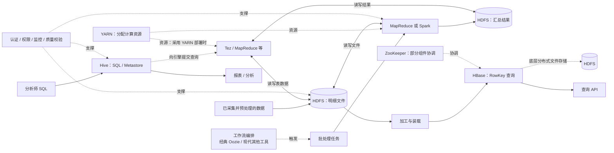

# Hadoop 生态圈 Vibe 知识视频｜完整分镜表

> 版本：V1.2（00–09 章完整静音网页快节奏版）<br>
> 编制日期：2026-11-17<br>
> 交付用途：全片网页制作与逐镜验收<br>
> 示例业务：一批已完成采集和预处理的**电商订单数据**，既要生成省份销售报表，也要支持订单号查询<br>
> 内容范围：从“已清洗数据准备入 Hadoop”开始，到存储、运行计算、分析/服务分支、工作流保障与输出

## 0. 创作定位与正确的技术叙事

**形式**：16:9 横版、1920×1080、30fps；深色极简科技感，前景为精确的二维/三维伪空间图形，动态图形承担知识解释，不是纯装饰。网页全片仅用中文字幕与图形讲解，不做音频，不导出。

**主视觉隐喻**：数据中心是一座可以俯视的“数据工厂”。每个功能区是固定位置的空间，镜头移动而不是反复生成无关画面：Hadoop Common（底层支撑带）、HDFS（分布式仓库）、YARN（计算资源调度大厅）、MapReduce/Spark（可选择的计算车间）、Hive（SQL 分析室）、HBase（低延迟查询服务区）；ZooKeeper、工作流编排、安全监控属于侧边支撑系统。

**知识上最关键的约束**：

1. **不是单链**：不能把 `HDFS → YARN → MapReduce → Spark → Hive → HBase` 画成每一条数据的固定顺序。
2. **存储 vs 资源**：HDFS 放文件、定位数据块；YARN 给运行中的分布式应用分配计算资源；Hadoop Common 为核心模块提供共用的基础库和工具。三者角色不同。
3. **计算多选一或按需组合**：MapReduce、Spark 是计算方案；Hive 是 SQL 分析入口，可能使用 Tez/MapReduce 等执行引擎（受版本和部署配置影响）。
4. **分析和服务分支**：Hive 适合扫描/聚合分析；HBase 适合按 RowKey 的随机读写，通常要另建服务表与装载流程。
5. **外围服务不承载业务数据主通道**：ZooKeeper 负责部分分布式协调；工作流工具负责作业依赖。Oozie 是经典生态组件，但 **Apache Oozie 在 2025 年已退役**，视频须明确标注其历史地位，不建议介绍为仍在活跃发展的首选组件。
6. **容错不是绝对保证**：副本、重试、HA、校验属于不同维度，不能宣称“任何情况下永不丢失、永不失败”。

### 视频叙事问题

- **问题 A**：2026-11-16 各省有多少订单、销售总额是多少？→ HDFS / 分布式计算 / Hive / 报表。
- **问题 B**：给定 `order_id`，如何较快获得订单状态？→ 处理后的服务数据 → HBase → API（仅作可选架构示例）。

### 全局场景地图（制作时建议始终保持空间关系一致）



> 此图为**角色关系示意**，不是逐字节的物理数据路径。实际 Hive、Spark、HBase、YARN 的组合因版本和部署而异。

## 1. 总时间轴

| 章节 | 时间 | 教学任务 | 视觉高潮 |
|---|---|---|---|
| 00｜开场与全局问题 | 00:00–00:26 | 提出完整问题、建立分层结构 | 订单暴涨；地图开层并亮出双出口 |
| 01｜数据入湖与组织 | 00:26–00:48 | 定义示例数据、组织文件 | 目标分区锁定；碎文件吸合 |
| 02｜HDFS：分布式存储 | 00:48–02:00 | 拆分、定位、复制、读取、恢复 | 巨块三分；写入绕开 NameNode；失联改道、新副本落位 |
| 03｜YARN：资源与任务启动 | 02:00–02:42 | 资源、容器与数据本地性 | 应用启动，资源舱落位 |
| 04｜并行计算：MapReduce 与 Spark | 02:42–03:55 | Map、Shuffle、Reduce 与 DAG | 同键跨台汇流；DAG 分阶段执行 |
| 05｜Hive：SQL 数据分析 | 03:55–04:40 | SQL、Metastore、分区与执行引擎 | 日期分区锁定，表格长成柱图 |
| 06｜HBase：在线随机读写分支 | 04:40–05:32 | 服务表、RowKey、Region 与更新时效 | 键落到目标 Region，订单状态回传 |
| 07｜编排、协调与可靠运行 | 05:32–06:23 | 作业依赖、协调、安全和故障恢复 | 编排与资源双轨，失败任务换舱 |
| 08｜服务输出与业务闭环 | 06:23–06:51 | 报表、API 与每日更新 | 两类结果交付，下一日分区接入 |
| 09｜总架构收束 | 06:51–07:15 | 多层协作、两条业务出口 | 错误单线拆开，重组为正确架构 |

**全片 07:15，10 章 59 镜。** 00–02 保持 02:00；03–09 从 02:00 接续，按静音阅读与动作重新排时。镜头 6–9 秒，复杂路径留足读图时间，不靠倍速。

## 2. 完整逐镜头分镜表

**静音也要看懂。** “视觉节拍”按入镜后的相对秒数标记；先看主体、再看关系变化、最后留出读图时间。开场半秒内有主体动作；每个 6–9 秒的镜头至少有两个可见的状态变化，用位置、尺寸、数量或路线变化讲解，而非每屏同样淡入。每次只突出一条主要关系。系统设为减少动态效果时，保留状态切换与字幕，移除疾行拖影、震动和快推。

### 00｜开场与全局问题

| 镜头 / 网页时间 | 画面与知识动作 | 无声字幕 / 标签 | 视觉节拍（镜内秒） |
|---|---|---|---|
| **S01**<br>00:00–00:06<br>6 秒 | 一张 O-1001 订单卡从近景闯入，由一叠复制卡展开为订单洪流。 | 一批订单进入 Hadoop 后，会发生什么？／汇总分析、订单点查 | 0–0.5 卡片即动；0.7–2.8 数量跃升至 1,000,000+（规模示意）；3.2 双问题板亮起。 |
| **S02**<br>00:06–00:12<br>6 秒 | 采集、清洗、去重、校验依次完成，数据工厂门打开。 | 从已预处理的订单开始 | 0–1.5 四枚状态依次锁定；1.6–3.2 门闸分开，订单文件从门外穿入。 |
| **S03**<br>00:12–00:20<br>8 秒 | 同一地图内展开 HDFS、YARN、计算／分析／服务；Hive 面向报表，HBase 面向点查。 | 存储、资源、计算、分析和服务各有分工，不是单链。 | 0–2.7 由下至上展开三层；3.4–5.5 路线铺开并点亮两个出口，读图定格。 |
| **S04**<br>00:20–00:26<br>6 秒 | 上层留在原位，Common 支撑带从地图下方升起；点线连核心模块，不走订单。 | Hadoop Common：共享库、工具、基础接口 | 0–1.4 底座从下方入位；1.4–3.0 点线逐段接入，衬出底座与业务通道的区别。 |

### 01｜数据入湖与组织

| 镜头 / 网页时间 | 画面与知识动作 | 无声字幕 / 标签 | 视觉节拍（镜内秒） |
|---|---|---|---|
| **S05**<br>00:26–00:34<br>8 秒 | 样例订单明细拉开；字段展示完整。用两种高亮比较汇总列与 O-1001 单条状态。 | 汇总看省份和金额；点查用订单号找状态。 | 0–1.7 三行依次入位；2.5 汇总列被框选；4.3 切到 O-1001 的订单号和状态。 |
| **S06**<br>00:34–00:42<br>8 秒 | 展开目录树，锁定 `dt=2026-11-16/`，将 Parquet 文件成组放入目标分区。 | 按日期分区；Parquet 文件（示例） | 0–2.0 目录展开；2.0–2.6 目标分区锁亮；2.6–5.4 文件沿导轨逐个落位。 |
| **S07**<br>00:42–00:48<br>6 秒 | 订单小文件堆满左侧，批量吸合成右侧少数大文件。 | 同一分区合并小文件，记录不变。 | 0–1.2 碎文件涌入；1.8–3.8 碎片成束吸合；停在左右对比。 |

### 02｜HDFS：分布式存储

| 镜头 / 网页时间 | 画面与知识动作 | 无声字幕 / 标签 | 视觉节拍（镜内秒） |
|---|---|---|---|
| **S08**<br>00:48–00:55<br>7 秒 | 进入分布式仓库：上方 NameNode 管目录，下方 DataNodes 存文件数据。 | NameNode 管目录和块位置；DataNode 存块。 | 0–1.1 仓库下沉入场；1.3–3.8 货架升起，块落到多个节点。 |
| **S09**<br>00:55–01:02<br>7 秒 | 近景巨型文件被两道切线切成 B1/B2/B3，三个块飞向不同节点。 | 按配置切块；B1 / B2 / B3 仅作示例。 | 0–1.5 切线扫过文件；1.5–2.9 三块拉开；2.9–5.3 飞入节点，落位有轮廓回波。 |
| **S10**<br>01:02–01:11<br>9 秒 | 上路交换元数据，下路直发数据块，NameNode 不在数据路线上。 | 申请创建 → 返回目标 → 客户端直写 DataNode | 0.4–2.4 小型虚线控制包上行；2.4–4.6 控制包返回；4.6–7.0 大数据块从下路穿过。 |
| **S11**<br>01:11–01:19<br>8 秒 | 同一个 B2 沿 Client → DN-A → DN-B → DN-C 传递，落地一个就保留一个。 | 同一个 B2 的副本；示例副本因子 3，可配置。 | 0.5–5.3 三段实线先后推进；到站逐个亮出 B2，最后同屏看清三个副本。 |
| **S12**<br>01:19–01:26<br>7 秒 | 拉开看到机架 A/B，B2 跨机架放置；一机架不可用时看另一机架副本。 | 放置考虑机架布局，不保证所有故障下都可读。 | 0–1.3 两个机架拉开；1.3–3.2 跨机架路线冲过间隙；3.5 以机架 A 不可用为例，机架 B 留亮。 |
| **S13**<br>01:26–01:34<br>8 秒 | 任务询问 NameNode 后锁定较近的可用副本，B2 从 DataNode 返回。 | 先定位，再直接读；条件允许时优先就近。 | 0.3–3.1 查询去回；3.2–4.1 圈定较近节点；4.1–6.4 大块逆向返回任务端。 |
| **S14**<br>01:34–01:43<br>9 秒 | DN-A 心跳中断，NameNode 超时标为不可用；读路切到 DN-B。 | 心跳／块报告 → 超时 → 改读存活副本 | 0–2 展示心跳；2.0 原路径熄灭、节点出现失联记号；3.8 超时；5.3–7.5 替代路径画出并返回 B2。 |
| **S15**<br>01:43–01:52<br>9 秒 | NameNode 指派重新复制，DN-B 横向把 B2 发给 DN-D；可用副本回到目标数。 | 2/3 → 3/3；重新复制降低风险，不保证数据不丢。 | 0.2–2.5 下发指令；2.5–5.7 块沿低位实线传送；约 5.7 新副本落位、计量条补齐。 |
| **S16**<br>01:52–02:00<br>8 秒 | 可选 HA：Active 写共享日志，Standby 同步；失联后在满足条件时接任。下方 DataNode 层始终不动。 | 切换的是元数据服务，不是迁移文件。 | 0.3–3.1 展示日志的写入与读取；3.3 原 Active 断开；约 5.0 接任状态和新写入方向亮出，留到本章结束。 |

### 03｜YARN：资源与任务启动

| 镜头 / 网页时间 | 画面与知识动作 | 无声字幕 / 标签 | 视觉节拍（镜内秒） |
|---|---|---|---|
| **S17**<br>02:00–02:06<br>6 秒 | 从按省汇总的需求提交作业卡；订单文件留在 HDFS。 | 作业提交的是任务描述，不是把订单搬进 YARN。<br>YARN 回答的不是“数据放哪”，而是“谁来给任务分资源”。 | 0–2.5s 建立主体与第一步；2.5s 后切换重点，完成后留屏。作业卡越过资源大厅门槛，仓库文件保持静止。 |
| **S18**<br>02:06–02:13<br>7 秒 | RM 负责集群级分配，多个 NM 管理本机容器并报告状态。 | ResourceManager（RM）做集群级资源分配。<br>NodeManager（NM）管理本机容器并汇报状态。 | 0–2.5s 建立主体与第一步；2.5s 后切换重点，完成后留屏。三台节点依次升起；先汇报状态，再展开资源分配关系。 |
| **S19**<br>02:13–02:22<br>9 秒 | Client 提交给 RM；RM 分配初始容器，NM 启动 AM；AM 向 RM 申请，获得资源后由 NM 启动任务容器。 | 客户端提交应用，RM 分配首个容器，由 NM 启动 AM。<br>AM 再向 RM 申请资源；分配后由 NM 启动任务容器。 | 0.25–1.65 客户端提交；1.65–3.35 首个 AM 舱落位；3.7–5.25 AM 申请；5.35–7.14 NM 启动任务舱，留屏。 |
| **S20**<br>02:22–02:29<br>7 秒 | CPU、内存额度填满资源舱并出现 Worker；HDFS Block 保持独立。 | Container 是任务的运行环境和 CPU、内存等资源额度。<br>Worker 在容器里执行；HDFS Block 则是文件的一段。 | 0–2.5s 建立主体与第一步；2.5s 后切换重点，完成后留屏。资源刻度填入、Worker 落位；镜头侧边亮出 B2 作对照。 |
| **S21**<br>02:29–02:36<br>7 秒 | 从跨机架候选切到较近、资源可用的任务位置。 | 能就近算，就少搬数据。<br>资源、队列和节点状态都有限制，并不保证就近。 | 0–2.5s 建立主体与第一步；2.5s 后切换重点，完成后留屏。长路先亮；较近节点资源就绪后改为短路。 |
| **S22**<br>02:36–02:42<br>6 秒 | MapReduce 与 Spark 两扇门并排，由 YARN 提供资源而非传输数据。 | 同一任务可选 MapReduce 或 Spark。<br>两条是可选路线，不是先跑完 MapReduce 再跑 Spark。 | 0–2.5s 建立主体与第一步；2.5s 后切换重点，完成后留屏。两条资源线向左右分开，计算门弹开。 |

### 04｜并行计算：MapReduce 与 Spark

| 镜头 / 网页时间 | 画面与知识动作 | 无声字幕 / 标签 | 视觉节拍（镜内秒） |
|---|---|---|---|
| **S23**<br>02:42–02:49<br>7 秒 | 输入分片分别到 Map 工作台；分片是处理单位，不等同于 HDFS 块。 | 输入分片描述每个 Map 任务要处理的那一部分。<br>多个 Map 可并行读数据，不必排队处理整份文件。 | 0–2.5s 建立主体与第一步；2.5s 后切换重点，完成后留屏。一份输入拆出多条轨道，Map 工作台几乎同时启动。 |
| **S24**<br>02:49–02:56<br>7 秒 | 样例订单提取省份与金额，生成三张 KV 卡片。 | 省份做键，金额做值。<br>江苏 100、广东 80、江苏 50，留给下一步分组。 | 0–2.5s 建立主体与第一步；2.5s 后切换重点，完成后留屏。字段卡向内折叠；三张键值对先后落位。 |
| **S25**<br>02:56–03:03<br>7 秒 | 同一个 Map 的局部示例：江苏 100 与 50 合并成 150；另一条路径不启用 Combiner。 | 求和可以先局部汇总，减少网络上的中间数据。<br>Combiner 是可选优化；不符合合并条件的任务不能硬套。 | 0–2.5s 建立主体与第一步；2.5s 后切换重点，完成后留屏。两张本地卡吸合，未启用的分支绕过合并。 |
| **S26**<br>03:03–03:12<br>9 秒 | Map 输出分区后跨工作台传输，按键排序并分组到 Reduce 端。 | 先按键分区，再跨节点传输。<br>到 Reduce 侧排序、分组；两个江苏值进同一组。 | 0–1.3 分区；1.3–5.34 三张 KV 交叉传输，两个江苏键进同一组，广东另成组；保留结果读图。 |
| **S27**<br>03:12–03:20<br>8 秒 | 用江苏 [100,50] 与广东 [80] 得到订单数与销售额。 | 江苏有 2 单，金额 150；广东有 1 单，金额 80。<br>Reduce 消费各自的键分组，不需要把所有订单集中到一个任务。 | 0–3s 建立主体与第一步；3s 后切换重点，完成后留屏。两组独立计数求和，数字落定后组成表。 |
| **S28**<br>03:20–03:26<br>6 秒 | 结果文件回到汇总目录，明细目录保持独立。 | 结果常写回 HDFS，供后续查询和加工。<br>汇总进结果目录，不覆盖原始订单明细。 | 0–2.5s 建立主体与第一步；2.5s 后切换重点，完成后留屏。结果包回流并落位；上下两层目录对齐。 |
| **S29**<br>03:26–03:35<br>9 秒 | 读取 HDFS，过滤、按省分组、聚合；Driver 组织 Stage 和 Task，Executor 执行。 | Spark 也能从 HDFS 读数据；算子依赖构成 DAG。<br>Driver 协调 Stage 和 Task，Executor 执行任务。 | 0–3s 建立主体与第一步；3s 后切换重点，完成后留屏。算子依赖图展开；分组边界分出 Stage，任务下落到 Executor。 |
| **S30**<br>03:35–03:42<br>7 秒 | 应用资源由 YARN 提供；Spark 自己组织计算；显示其他部署选择而非强依赖。 | 这条是 Spark on YARN：YARN 分配资源，Spark 执行。<br>Spark 也可以用其他集群管理环境。 | 0–2.5s 建立主体与第一步；2.5s 后切换重点，完成后留屏。上下两层拉开：先亮资源线，再亮 Spark 执行端。 |
| **S31**<br>03:42–03:49<br>7 秒 | 第一次把中间结果按需缓存，第二次复用；Shuffle 可能落盘。 | 中间结果按需缓存，适合重复使用。<br>缓存不等于永不落盘，Shuffle 也可能用磁盘。 | 0–2.5s 建立主体与第一步；2.5s 后切换重点，完成后留屏。首次线路较长，二次切换为短路；磁盘提示保留。 |
| **S32**<br>03:49–03:55<br>6 秒 | MapReduce 和 Spark 并排从 HDFS 输入、写回结果区。 | MapReduce 偏经典批处理；Spark 是通用计算引擎。<br>两者都能读写 HDFS，选用哪条按需求决定。 | 0–2.5s 建立主体与第一步；2.5s 后切换重点，完成后留屏。同一个存储层引出两路，输出回到同一区域。 |

### 05｜Hive：SQL 数据分析

| 镜头 / 网页时间 | 画面与知识动作 | 无声字幕 / 标签 | 视觉节拍（镜内秒） |
|---|---|---|---|
| **S33**<br>03:55–04:02<br>7 秒 | 显示一致的订单 SQL，使用 dt=2026-11-16，并按 province 分组。 | 分析师问：这一天，各省有多少单、卖了多少？<br>Hive 提供 SQL 分析入口，不需要自己写分布式程序。 | 0–2.5s 建立主体与第一步；2.5s 后切换重点，完成后留屏。SELECT、WHERE、GROUP BY 依次定位，不逐字播放。 |
| **S34**<br>04:02–04:09<br>7 秒 | Metastore 保存列、分区与位置；HDFS 保存 Parquet。 | Metastore 记录表、列、分区和存储位置。<br>注册表并不会把订单文件搬进 Metastore。 | 0–2.5s 建立主体与第一步；2.5s 后切换重点，完成后留屏。左侧元数据标签接出虚线，右侧文件不迁移。 |
| **S35**<br>04:09–04:16<br>7 秒 | 三个日期分区对照，查询仅选中 2026-11-16。 | 明确筛选分区字段 dt。<br>执行计划有机会只扫 11 月 16 日的分区。 | 0–2.5 展示三处候选分区；2.5 锁定中间目标、两侧压暗；2.62–4.55 仅沿目标路径读取。 |
| **S36**<br>04:16–04:25<br>9 秒 | HiveServer2 接收 SQL，查询 Metastore，解析并优化后提交配置的执行引擎。 | 通过 HiveServer2 提交 SQL，结合元数据解析和优化。<br>Hive 生成执行计划，再交给配置的计算引擎。 | 0–3s 建立主体与第一步；3s 后切换重点，完成后留屏。SQL 卡进 HS2；元数据虚线去回；计划卡交给引擎。 |
| **S37**<br>04:25–04:32<br>7 秒 | Hive、Tez／MapReduce、HDFS 与可选 YARN 资源关系分层；Spark 支持依历史版本和特定环境。 | 可用的引擎取决于版本与部署配置。<br>Hive 是 SQL 分析层；HDFS 存文件，YARN 管资源。 | 0–2.5s 建立主体与第一步；2.5s 后切换重点，完成后留屏。层板拉开，先亮控制关系，再亮引擎与文件的读写。 |
| **S38**<br>04:32–04:40<br>8 秒 | 先填结果表，再从数据行展开 GMV 柱图；可返回或写入汇总表。 | 结果是省份、订单数与销售额。<br>结果可返回给分析师，也可写成新的汇总表。 | 0–3s 建立主体与第一步；3s 后切换重点，完成后留屏。两行统计入位，江苏 150、广东 80 的柱体从基线长出。 |

### 06｜HBase：在线随机读写分支

| 镜头 / 网页时间 | 画面与知识动作 | 无声字幕 / 标签 | 视觉节拍（镜内秒） |
|---|---|---|---|
| **S39**<br>04:40–04:46<br>6 秒 | 延续上一章报表，分屏引出按订单号查询。 | 报表回答“各省卖了多少”。<br>点查要回答“这一笔订单是什么状态”。 | 0–2.5s 建立主体与第一步；2.5s 后切换重点，完成后留屏。报表退到左侧，输入框从右侧入场并锁定 O-1001。 |
| **S40**<br>04:46–04:54<br>8 秒 | HDFS 明细经加工／装载进 HBase；与分析报表分离。 | 从明细加工和装载适合点查的数据。<br>HBase 是可选服务分支，不必经过 Hive 的查询结果。 | 0–3s 建立主体与第一步；3s 后切换重点，完成后留屏。分析分支保留在上方，下方装载轨道独立展开。 |
| **S41**<br>04:54–05:02<br>8 秒 | 键范围划分为多个 Region，由不同 RegionServer 管理；订单号为示意。 | 表按 RowKey 范围分成多个 Region。<br>实际 RowKey 需要设计，避免读写集中在少数节点。 | 0–3s 建立主体与第一步；3s 后切换重点，完成后留屏。键轴拉长、分段、下沉到对应服务器，O-1001 锁定目标。 |
| **S42**<br>05:02–05:11<br>9 秒 | RegionServer 写 WAL 和 MemStore；后台 Flush 将 MemStore 刷成 HFile，底层通常为 HDFS。 | RegionServer 写 WAL，也把更新放进 MemStore。<br>后台 Flush 将 MemStore 刷成 HFile，通常落在 HDFS。 | 0–3s 建立主体与第一步；3s 后切换重点，完成后留屏。请求分出两路；WAL 留存，只有 MemStore 向下刷成 HFile。 |
| **S43**<br>05:11–05:19<br>8 秒 | 客户端定位目标 RegionServer，按 RowKey 读取并返回 O-1001 的状态。 | 客户端定位 RegionServer，再按 RowKey 读取。<br>合理设计的键可以支持低延迟随机读写。 | 0.6–2.82 定位目标 RegionServer 后发出请求；3.1–5.38 状态逆向返回，结果留屏。 |
| **S44**<br>05:19–05:26<br>7 秒 | 并列每日装载与持续更新；区分快速应答、数据新鲜度。 | 请求响应很快，读到的却可能是昨天的快照。<br>更新频率决定数据有多新，与查询耗时不是一回事。 | 0–2.5s 建立主体与第一步；2.5s 后切换重点，完成后留屏。两个响应几乎同时出现，但快照时间先后分离。 |
| **S45**<br>05:26–05:32<br>6 秒 | 左为 SQL 聚合报表，右为一键返回状态；HDFS 位于底层。 | Hive 侧重 SQL 扫描和聚合分析。<br>HBase 侧重按 RowKey 随机读写，不互相替代。 | 0–2.5s 建立主体与第一步；2.5s 后切换重点，完成后留屏。左汇成柱图，右弹出单条状态；底层存储仍可见。 |

### 07｜编排、协调与可靠运行

| 镜头 / 网页时间 | 画面与知识动作 | 无声字幕 / 标签 | 视觉节拍（镜内秒） |
|---|---|---|---|
| **S46**<br>05:32–05:39<br>7 秒 | 到数与校验后并行展开报表聚合和服务表更新，最后通知。 | 工作流负责等待、校验、按依赖启动任务。<br>报表和服务表可分支运行，满足依赖后再通知。 | 0–2.5s 建立主体与第一步；2.5s 后切换重点，完成后留屏。上游校验到站，再开两条支线，末端汇合。 |
| **S47**<br>05:39–05:45<br>6 秒 | Oozie 时间标记移入历史栏，2025 退役；Airflow 等作现代例子。 | Oozie 曾用于 Hadoop 工作流与定时任务。<br>Apache Oozie 已在 2025 年退役，新项目可考虑其他工具。 | 0–2.5s 建立主体与第一步；2.5s 后切换重点，完成后留屏。旧卡退场，退役年份定住，另一张方案卡入位。 |
| **S48**<br>05:45–05:52<br>7 秒 | 上轨工作流排列依赖，下轨 YARN 分配计算资源。 | 工作流决定下一步该启动谁。<br>YARN 决定启动的应用能分到什么资源。 | 0–2.5s 建立主体与第一步；2.5s 后切换重点，完成后留屏。上轨依次解锁；下轨在应用启动后填充资源舱。 |
| **S49**<br>05:52–05:59<br>7 秒 | 协调线只连接依赖者，例如 HBase；业务订单绕行。 | ZooKeeper 提供分布式协调，存的是协调状态。<br>只连依赖它的组件，不经过每条业务数据。 | 0–2.5s 建立主体与第一步；2.5s 后切换重点，完成后留屏。协调状态走虚线；业务块沿独立实线路径横穿。 |
| **S50**<br>05:59–06:07<br>8 秒 | Map 任务重试；存储副本、计算重试和工作流告警各自运作。 | 任务失败可以重试，HDFS 副本属于存储容错。<br>编排还可以按规则重试或告警；策略因部署和引擎而异。 | 0–3s 建立主体与第一步；3s 后切换重点，完成后留屏。故障任务退出旧节点，重新调度到新节点；副本始终保留。 |
| **S51**<br>06:07–06:15<br>8 秒 | 重复分区结果出现，使用示例分区覆盖与校验归一；可配合去重或幂等写入。 | 重跑同一天，不应生成重复累计结果。<br>用分区覆盖、去重或幂等写入，再核对订单数与金额。 | 0–3s 建立主体与第一步；3s 后切换重点，完成后留屏。双份结果叠出，覆盖后只留一份，总量校验锁定。 |
| **S52**<br>06:15–06:23<br>8 秒 | 认证、授权与监控各自成层；示例为 Kerberos、HDFS 权限、日志与资源指标。 | Kerberos 可用于身份认证，HDFS 权限控制访问。<br>用资源指标、作业日志与告警观察异常。 | 0–3s 建立主体与第一步；3s 后切换重点，完成后留屏。访问先验身份再校验权限；底部监控线出现并标记告警。 |

### 08｜服务输出与业务闭环

| 镜头 / 网页时间 | 画面与知识动作 | 无声字幕 / 标签 | 视觉节拍（镜内秒） |
|---|---|---|---|
| **S53**<br>06:23–06:31<br>8 秒 | 将样例汇总写成运营看板，地图省份示意与 GMV 柱图联动。 | 分析结果变成运营报表。<br>用同一批样例比较各省订单数与销售额。 | 0–3s 建立主体与第一步；3s 后切换重点，完成后留屏。汇总表进入 BI；江苏、广东的标记与柱图依次点亮。 |
| **S54**<br>06:31–06:38<br>7 秒 | 业务 API 读 HBase 服务表，响应订单号和订单状态。 | 业务接口可以从 HBase 服务表点查订单。<br>O-1001 返回“已发货”；这是一种可选实现。 | 0–2.5s 建立主体与第一步；2.5s 后切换重点，完成后留屏。请求穿过 API 到服务表，响应返回并展开 JSON。 |
| **S55**<br>06:38–06:44<br>6 秒 | 以汇总或加工结果为中心，分支到数据集市、推荐特征、告警和数据导出。 | 有用的数据产物也能作为其他系统的输入。<br>报表、特征、告警和数据导出可按需建设。 | 0–2.5s 建立主体与第一步；2.5s 后切换重点，完成后留屏。结果块同时分流，四个出口逐一落位。 |
| **S56**<br>06:44–06:51<br>7 秒 | 次日分区入仓并触发等待、校验、发布；看板更新。 | 新分区进入 HDFS，触发下一轮工作流。<br>按依赖校验并发布，报表和服务继续更新。 | 0–2.5s 建立主体与第一步；2.5s 后切换重点，完成后留屏。日期翻页，订单文件进入下一分区；发布状态重新点亮。 |

### 09｜总架构收束

| 镜头 / 网页时间 | 画面与知识动作 | 无声字幕 / 标签 | 视觉节拍（镜内秒） |
|---|---|---|---|
| **S57**<br>06:51–06:59<br>8 秒 | 重现 HDFS、YARN、计算、分析、服务和旁侧治理，Common 在下方支撑。 | HDFS 存文件，YARN 分资源，计算框架执行。<br>Hive 面向分析，HBase 提供一类随机读写服务。 | 0–3s 建立主体与第一步；3s 后切换重点，完成后留屏。三层先后展开，控制和数据路线依各自线型接入。 |
| **S58**<br>06:59–07:07<br>8 秒 | 短暂出现明确标错的单链，再拆开回到分层与分支图。 | 不要记成 HDFS、YARN、MR、Spark、Hive、HBase 顺序串行。<br>记住每层负责什么，以及数据、资源和控制怎样协作。 | 0–0.95 明确标注错误单线；0.95 划掉串行路径；1.55–3.05 组件移回各层，约 6.5 双出口展开，停在正确全景。 |
| **S59**<br>07:07–07:15<br>8 秒 | 订单进入后分别点亮省份报表与订单 API；最后留屏。 | 按省看销售；按订单号查状态。<br>存得下、算得动、查得到，数据才用得上。 | 0–3s 建立主体与第一步；3s 后切换重点，完成后留屏。第一路落到省份汇总，第二路返回订单状态；双终点定格。 |

## 3. 必须制作的“重点讲解动画”及验收点

| 资产编号 | 资产名称 | 必须看见的技术因果 | 常见错误（不得出现） |
|---|---|---|---|
| AN-01 | HDFS 读写分离图 | Client 先与 NameNode 交换元数据，再与 DataNode 读写文件数据；块和副本明确区分 | 文件内容全部先经过 NameNode |
| AN-02 | 副本与故障恢复 | 示例副本因子 3，节点失联后仍有存活副本，恢复复制；不能承诺绝对零风险 | 每份文件都固定复制三份、节点故障必不影响任何读写 |
| AN-03 | YARN 任务启动 | Client 提交应用 → RM 分配初始容器 → AM 申请资源 → NM 启动任务容器 | 把 YARN 画成“数据流过的传送带” |
| AN-04 | MR 完整链路 | Input split → Map →（可选 Combiner）→ Shuffle（分区/排序/分组）→ Reduce → 输出 | Map 完之后跳过 Shuffle，直接显示 Reduce |
| AN-05 | Spark DAG | Spark 读取分布式存储，Driver 协调 Stages/Tasks，Executor 执行；Spark on YARN 是此片采用的部署选项 | 说 Spark 永远不落盘、永远必须运行于 YARN |
| AN-06 | Hive 三层关系 | SQL/HS2、Metastore 元数据、执行引擎与 HDFS 数据文件区分；分区裁剪可见 | 说 Hive 是 HDFS 后面必经的一段数据加工流水线 |
| AN-07 | HBase 独立分支 | 明细数据加工/装载为在线服务表；RowKey → RegionServer → 响应；WAL/MemStore/HFile 用小镜头说明 | 把 HBase 画成 Hive SQL 执行完才被动接收所有数据 |
| AN-08 | 编排与调度对照 | 工作流工具决定依赖/顺序，YARN 决定执行资源，两条轨道并列 | 说 Oozie 和 YARN 是同一种调度器 |
| AN-09 | ZooKeeper 协调定位 | 只用虚线联系其依赖的组件；HBase 的协调举例 | 把 ZooKeeper 画成通用数据交换中心 |
| AN-10 | 片尾全景重构 | 用分层架构明确替换错误的“一条线全部串行” | 片尾仍用 HDFS→YARN→MR→Spark→Hive→HBase 作为唯一流程 |

## 4. 屏幕中的示例数据（保持全片一致）

### 4.1 订单明细

| order_id | user_id | province | amount | order_status | ts |
|---|---|---|---:|---|---|
| O-1001 | U-01 | 江苏 | 100.00 | 已发货 | 2026-11-16 09:10:00 |
| O-1002 | U-02 | 广东 | 80.00 | 已支付 | 2026-11-16 09:12:00 |
| O-1003 | U-03 | 江苏 | 50.00 | 已完成 | 2026-11-16 09:14:00 |

> 样例只是动画演示数据；屏幕中的“百万订单”是规模感示意，不应由这三行数据推导出真实统计结果。

### 4.2 MapReduce 中间结果

```text
Input:  江苏100 / 广东80 / 江苏50
Map:    (江苏,100) (广东,80) (江苏,50)
Shuffle & Group:
        江苏 -> [100, 50]
        广东 -> [80]
Reduce:
        江苏 -> 150
        广东 -> 80
```

### 4.3 Hive SQL（务必用一致的日期与字段）

```sql
SELECT
    province,
    COUNT(*) AS orders,
    SUM(amount) AS gmv
FROM dwd_orders
WHERE dt = '2026-11-16'
GROUP BY province;
```

> 约定 `dwd_orders` 已通过 Hive Metastore 登记，`dt` 为分区字段，底层文件示意位于 `/warehouse/dwd/orders/dt=2026-11-16/`。不要误导成“执行 CREATE TABLE 就把 HDFS 文件自动搬到数据库里”。

### 4.4 在线查询示例

```text
GET /orders/O-1001
     ↓ 业务查询服务（示例）
HBase GET rowkey=O-1001
     ↓
{ "order_id": "O-1001", "status": "已发货" }
```

> 这是为了解释 HBase 分支而设定的示例，不代表推荐直接用 HBase 代替所有交易数据库。真实场景会另行考虑写入链路、数据同步时效与一致性要求。

## 5. 统一视觉系统和动画规格

- **底色**：接近黑色的蓝灰（如 `#0B1020`）；深灰网格仅用于空间感，不应抢阅读焦点。
- **功能色**：HDFS 青蓝、YARN 琥珀、MapReduce 青绿、Spark 紫色、Hive 金色、HBase 红橙、ZooKeeper 中性银、工作流灰紫；颜色只作为定位标识，全程固定，不随镜头乱变。
- **数据标识**：每一条原始订单用小六面体；一批订单文件用较大立方体；HDFS Block 用标记 `B1/B2/B3` 的块；YARN Container 用有 CPU/内存进度条的资源舱。四者外形必须明显不同。
- **连接语义**：实线流光表示数据读写；虚线表示控制、元数据、协调或触发；点线强调依赖。每一类线配有固定图例。
- **镜头语言**：用较大的推进、切分、拉开与改道承载知识转折，主要状态稳定后让观众读图，不让炫光掩盖概念。
- **文字**：主标题 58–76 px，模块名称 42–56 px，图中标签 26–34 px，字幕 40–48 px；16:9 安全边距不少于画布宽度的 5%。
- **字幕**：中文，关键技术名词保留英文。网页按知识动作换短句，不跟录音排时；关键字幕给约 2–4 秒，窄屏看不清可读播放器外的当前字幕。
- **动效基础**：30fps。网页关键动作有前后状态，用短促起势、清楚的路径或形变、可读的落点构成重拍；不靠持续闪烁或全屏闪白。
- **声音**：当前只做无声网页，不制作旁白、配乐或音效。
- **可访问性**：除颜色以外还用名称、形状、线型区分组件；不要使用持续闪烁或过强发光；图内短英文可配中文释义。

## 6. 网页工程与验收

```text
index.html                     # 浏览器播放器
src/clock.ts                   # 播放、暂停、定位与重播
src/timeline.ts                # 全片镜头区间、章节与字幕入口
src/continuation.ts            # 03–09 的镜头起点与无声字幕
src/orders.ts                  # 三条订单样例
src/visual/                    # 场景画师和 Canvas 绘制工具
tests/timeline.test.ts         # 文档与实现的时间轴对照
```

**网页全片验收**：检查 S01–S59，按 AN-01～AN-10 验收动作起因、过程与落点，尤其是 S19 的任务舱启动、S26 的 Shuffle 汇流、S35 的分区裁剪、S43 的点查和 S58 的架构重组；浏览器中核对字幕、路线方向、章节跳转和减少动态效果模式，不渲染视频。

## 7. 知识点完整性检查清单

- [ ] 明确上游采集与清洗已完成；此片从写入 Hadoop 体系开始。
- [ ] 使用一个连贯订单案例，而非每一章切换完全不同的业务。
- [ ] 解释 Hadoop Common 的共享基础作用；解释 HDFS：NameNode/DataNode、块、副本、读/写、心跳、重新复制、可选 HA。
- [ ] 解释 YARN：RM/NM/AM/Container、提交过程、数据本地性。
- [ ] 解释 MapReduce：Map、可选 Combiner、Shuffle、Reduce、写回 HDFS。
- [ ] 解释 Spark：Driver、Executor、Stage/Task、按需缓存、Spark on YARN 仅为部署选择。
- [ ] 解释 Hive：SQL、HiveServer2、Metastore、分区裁剪、计算执行引擎、查询结果。
- [ ] 解释 HBase：服务分支、RowKey、Region、RegionServer、WAL、MemStore、HFile、单条查询。
- [ ] 解释工作流编排与 YARN 的区别，明确 Oozie 已于 2025 年退役。
- [ ] 解释 ZooKeeper 是协调组件，并非承载所有数据。
- [ ] 解释重试、幂等、校验、安全、监控与故障恢复。
- [ ] 业务结果同时体现分析报表和按键查询两个出口。
- [ ] 最后用正确的多层架构图**纠正单链误解**。

## 8. 按需扩展，但不应硬塞进主线的组件

| 组件/技术 | 所属位置 | 是否需要新增镜头 | 原因 |
|---|---|---|---|
| Kafka / Flume / Sqoop / NiFi | 上游采集与接入 | 否 | 用户指定从采集与预处理完成后开始，片头标识即可 |
| Pig | 历史/补充的数据流脚本工具 | 可做附录 | 不是当前订单示例的必经计算环节 |
| Tez | Hive 等系统可使用的执行引擎 | 已在 Hive 小节出现 | 有助于避免“Hive 自己完成所有计算”的误解 |
| HCatalog / Hive Metastore | 表与元数据管理 | 核心讲 Metastore；HCatalog 可附录 | 主线保留表/文件关系即可 |
| Mahout | 机器学习生态 | 可附录 | 与本片的统计/点查问题无直接因果关系 |
| Hue / Zeppelin | 交互式分析界面 | 可在输出示意图中点到 | 前端入口，不是底层数据必须经过的环节 |
| Ranger / Knox / Ambari | 权限、网关、管理 | 可附录 | 主线已经包含安全与监控理念，详细部署超出“一份数据的旅程” |
| Airflow 等工作流工具 | 编排层 | Oozie 现状镜头以现代方案举例 | 不能将已退役的 Oozie 描绘成唯一/最新选择 |
| Flink / 实时计算 | 可选实时分支 | 另起续篇 | 本片以“清洗后批处理订单”为主，避免混淆实时流和离线计算 |

## 9. 事实核验与官方参考

以下文档用于技术校对，不是视频内必须展示的资料页：

1. Apache Hadoop — HDFS Architecture: https://hadoop.apache.org/docs/r3.4.3/hadoop-project-dist/hadoop-hdfs/HdfsDesign.html
2. Apache Hadoop — HDFS High Availability: https://hadoop.apache.org/docs/r3.4.2/hadoop-project-dist/hadoop-hdfs/HDFSHighAvailabilityWithQJM.html
3. Apache Hadoop — Writing YARN Applications: https://hadoop.apache.org/docs/current/hadoop-yarn/hadoop-yarn-site/WritingYarnApplications.html
4. Apache Spark — Running on YARN: https://spark.apache.org/docs/latest/running-on-yarn/
5. Apache Hive — HiveServer2 Overview: https://hive.apache.org/docs/latest/user/hiveserver2-overview/
6. Apache Hive — Official Website (Metastore): https://hive.apache.org/
7. Apache HBase — Reference Guide: https://hbase.apache.org/book.html
8. Apache HBase — Regions: https://hbase.apache.org/docs/architecture/regions/
9. Apache Oozie — Apache Attic retirement record: https://attic.apache.org/projects/oozie.html
10. Apache Hadoop — HDFS permissions: https://hadoop.apache.org/docs/stable/hadoop-project-dist/hadoop-hdfs/HdfsPermissionsGuide.html

**视频定位说明**：这是一条以经典 Hadoop/HDFS/YARN 架构为核心的完整教学叙事，既包含历史生态的经典组件，也明确了现今组件状态和可选路径；不是某个指定发行版的部署操作手册，更不是声称所有企业都采用同样的技术栈。
